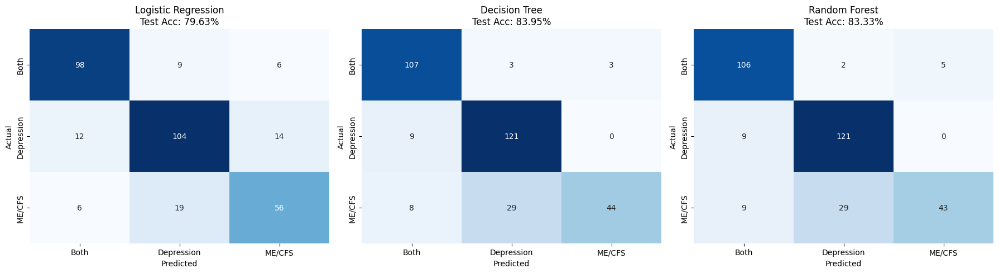
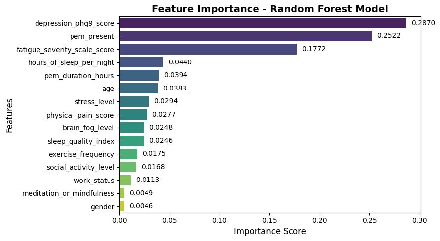

# ME/CFS vs Depression: Multi-class Diagnostic Triage Model

Machine-learning prototype that separates **ME/CFS**, **Depression**, and **Both** from self-reported symptom scores, with a cost-sensitive evaluation and a deployment recommendation for clinical triage.

> Group project for *Introduction to Data Science* (University of Nottingham Ningbo China, BUSI3122), Group 18.
> **My contribution:** Random Forest feature-importance analysis, the deployment recommendation (pilot design, human-in-the-loop triage, monitoring plan), and the saved-model inference script. The rest of the pipeline was a team effort.
>
> The data is **simulated** and this is a research prototype, **not a medical device**.

## Business problem

ME/CFS and depression share many symptoms (fatigue, poor sleep, brain fog), and misclassification is common. A wrong call delays treatment, and a false negative is the more serious error. The goal is a triage-support model that helps clinicians route patients, with a human making the final decision.

## Data

1,620 records, 15 features and a 3-class target (ME/CFS 40%, Depression 35%, Both 25%). Features cover PHQ-9, Fatigue Severity Scale, post-exertional malaise (PEM), sleep, stress, brain fog, pain and lifestyle. About 1.3% of cells were missing, with no systematic pattern. See [`data/README.md`](data/README.md).

## Approach

1. **Cleaning:** mean imputation for numeric features, random-sample imputation for categorical ones.
2. **EDA:** missingness heatmap, class balance, features by diagnosis, correlations.
3. **Modelling:** Multinomial Logistic Regression, Decision Tree, Random Forest. 80/20 stratified split, 5-fold stratified CV, `GridSearchCV` for hyperparameters, majority-class baseline.
4. **Evaluation:** accuracy, precision/recall/F1, confusion matrices, one-vs-rest ROC/AUC, and a **custom cost matrix** that penalises clinically worse errors more heavily (for example, predicting Depression for a true ME/CFS case costs the most).

## Results

Baseline (majority class): **40.12%** accuracy.

| Model | CV accuracy (5-fold) | Test accuracy | Precision | Recall | F1 | Total cost (lower is better) |
|---|---|---|---|---|---|---|
| Logistic Regression | 79.86% | 79.63% | 78.98% | 78.62% | 78.77% | **-344** |
| Decision Tree | 82.41% | **83.95%** | **86.33%** | **80.70%** | **81.52%** | -372 |
| Random Forest | **82.87%** | 83.33% | 84.89% | 79.99% | 80.64% | -376 |

Random Forest macro-average AUC (one-vs-rest): **0.95**.



**Key findings**
- The strongest drivers are the PHQ-9 score, PEM presence and the fatigue severity score (together about 72% of Random Forest feature importance). Sleep, stress, age and lifestyle variables matter far less.
- The most common error is ME/CFS predicted as Depression (29 of 81 ME/CFS test cases for both tree models). That is also the most expensive error in the cost matrix.
- Logistic Regression has the lowest total cost, but the tree-based models separate the classes better (higher accuracy and F1).
- Random Forest's train-test gap is larger (about 10 points) than the Decision Tree's, so it carries more overfitting risk.



### Robustness check
Imputation in the original notebook was fitted on the full dataset before splitting. I re-ran the same models with imputation (mean / most-frequent) and one-hot encoding inside a cross-validation pipeline (`scikit-learn` 1.9). CV accuracy was 79.7% (LR), 82.3% (DT) and 83.5% (RF), matching the table above. Test accuracy was about 3 points lower (76.9%, 80.9%, 80.6%), which is within the noise of a 324-row test set and a different imputation/encoding. The ranking (RF ≈ DT > LR) did not change.

## Recommendation

Deploy the Random Forest as a **decision-support tool with clinical oversight**: a 3-month pilot in neurology and psychiatry clinics, low-confidence cases escalated to experts, and monitoring of macro-F1, false-negative rate and feature drift. Because it scored a higher cost than Logistic Regression under the cost matrix, cost-aware monitoring is part of the plan.

## Limitations

- Simulated data, so real-world performance is unknown.
- Self-reported scales only. No objective markers or longitudinal data.
- The cost matrix values are illustrative assumptions, not clinical estimates.
- Fairness across demographic groups was not evaluated.

## Repository structure

```
notebooks/me_cfs_vs_depression.ipynb   full analysis (EDA, modelling, evaluation, cost-benefit)
src/predict.py                         predict one record with the saved model
models/                                trained Random Forest + label encoders
figures/                               key plots
data/                                  data description (dataset not redistributed)
```

## Run it

```bash
pip install -r requirements.txt
python src/predict.py                  # prediction on an example record
jupyter notebook notebooks/            # needs data/group_18.csv (see data/README.md)
```

The `.pkl` files were saved with `scikit-learn==1.4.2`. Use that version to load them without warnings.
